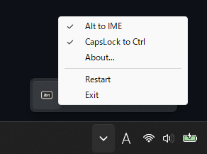

# ime-alt

  

A lightweight tool that provides Mac-like IME switching on Windows with a US keyboard layout.

## Features

Switch IME on and off using the Alt keys, similar to switching input modes on macOS:

- **Right Alt** (right of the space bar) ➔ IME ON
- **Left Alt** (left of the space bar) ➔ IME OFF
- **CapsLock** ➔ **Ctrl** (optional, see [Remapping CapsLock to Ctrl](#remapping-capslock-to-ctrl))

## Installation

`ime-alt` is portable and requires no installer.

1. Download the latest binary from [Releases](https://github.com/naotsugu/ime-alt/releases).
2. Extract the downloaded ZIP file to a folder of your choice.
3. Run `ime-alt.exe`.

## Startup

To automatically start `ime-alt` when Windows boots, add a shortcut for `ime-alt.exe` to the Windows Startup folder:

1. Place `ime-alt.exe` in the folder where you want to keep it.
2. Right-click `ime-alt.exe` and select **Create shortcut**.
3. Press `Win + R` to open the **Run** dialog, enter `shell:startup`, and press **Enter**.
4. Move the shortcut you created into the Startup folder.

> [!NOTE]
> If you move `ime-alt.exe` to another folder later, you will need to update or recreate the shortcut.

## Usage

1. Run `ime-alt.exe` to start the application in the background. It will display an icon in the system tray.
2. To exit the application, right-click the system tray icon and select **Exit**.

## Remapping CapsLock to Ctrl

`ime-alt` can also remap the CapsLock key to Ctrl.
This feature is optional and disabled by default.

To enable or disable it, right-click the `ime-alt` icon in the system tray and select **CapsLock to Ctrl**.

> [!IMPORTANT]
> The remapping is implemented by modifying the Scancode Map in the Windows registry
> (`HKEY_LOCAL_MACHINE\SYSTEM\CurrentControlSet\Control\Keyboard Layout`), rather than hooking keyboard events.
> Therefore:
>
> - **Administrator privileges** are required to change this setting.
> - You need to **sign out** (or restart Windows) and sign back in for the change to take effect.
>
> Implementing modifier remapping via keyboard hooks can be unreliable because key-up events are sometimes dropped. Updating the Scancode Map in the registry is the most stable approach because the remapping is handled natively by Windows.

## Uninstallation

1. If you enabled **CapsLock to Ctrl**, uncheck it from the tray menu first (and sign out / back in) to revert the registry change.
2. Exit the application by right-clicking the system tray icon and choosing **Exit**.
3. Delete `ime-alt.exe` (and its folder).
4. If you added `ime-alt` to the Windows Startup folder, remove its shortcut from the Startup folder (`shell:startup`).

## Notice on Antivirus False Positives

The application executable may occasionally be flagged as malware or a Trojan by some antivirus (AV) software, particularly engines utilizing machine learning heuristics. Such false positives are relatively common with binaries compiled in Rust.

While it might be possible to temporarily mitigate this by tweaking optimization flags or swapping dependency crates to alter binary signatures, such workarounds are not maintained in this repository. This issue is limited to a small number of AV programs, and attempting to continuously bypass heuristic detection turns into an endless cat-and-mouse game.

If your AV software flags `ime-alt.exe` as malicious, please consider reporting it as a false positive through your AV vendor's official submission form.
